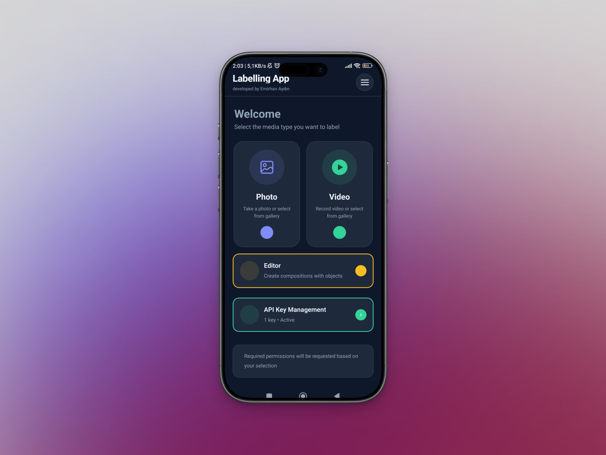
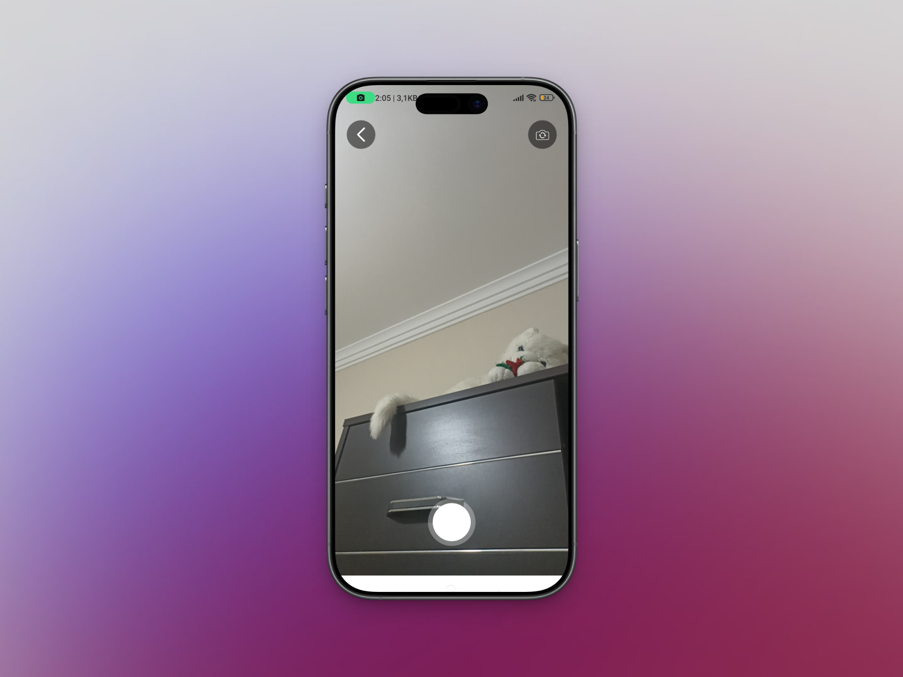
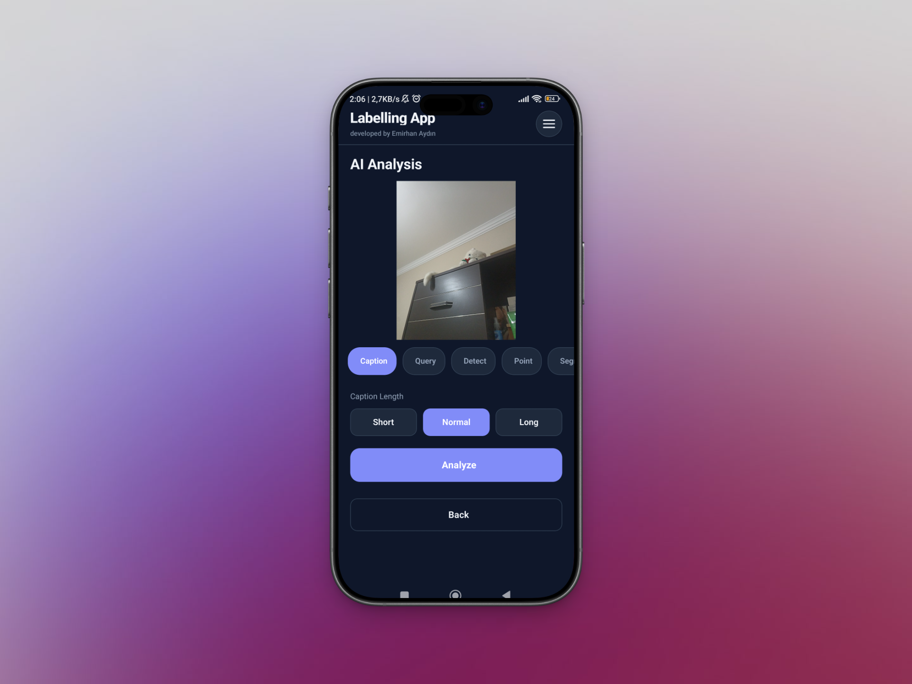
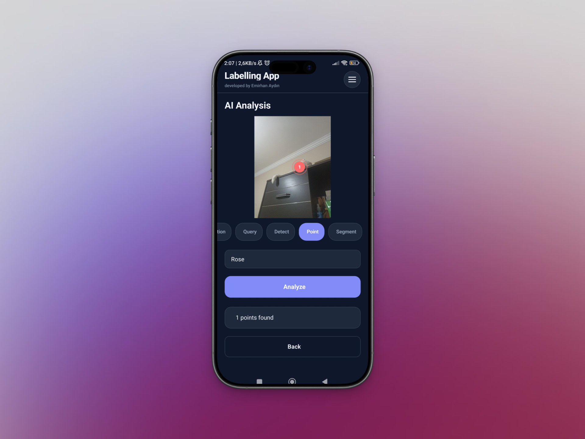
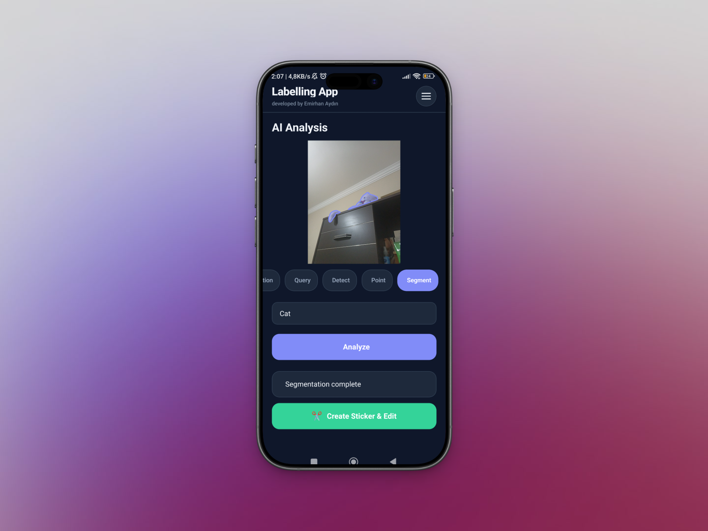
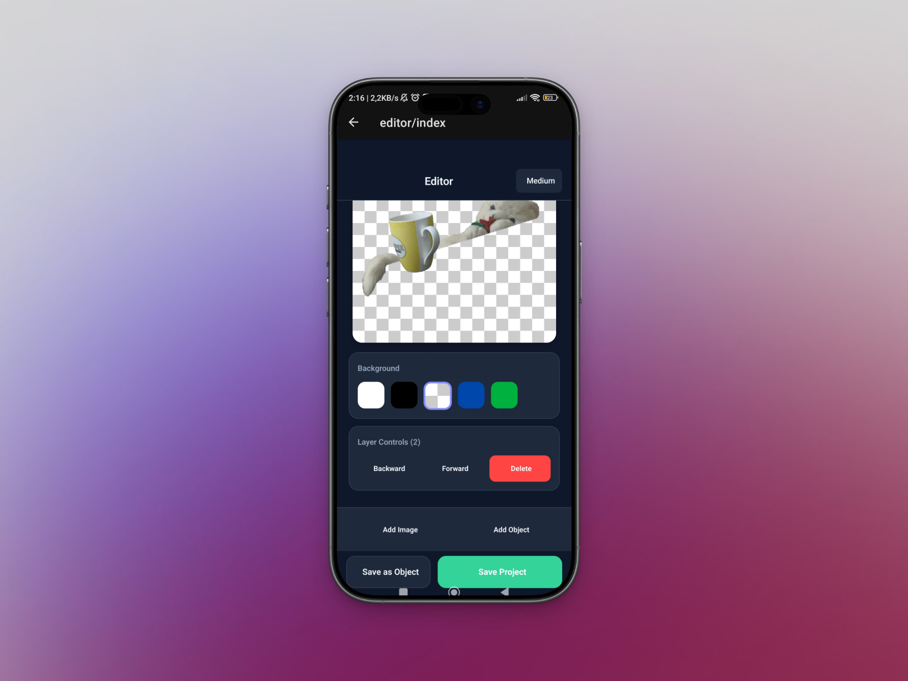
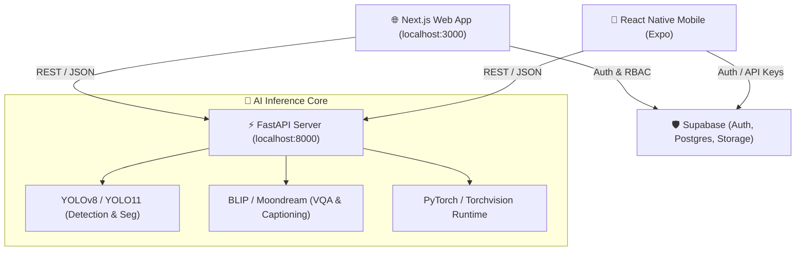

# 🌟 SceneAI Tool — AI-Powered Computer Vision & Labeling Platform

> **SceneAI Tool** is an end-to-end, enterprise-grade platform for AI-assisted image annotation, dataset management, object detection, segmentation, and real-time computer vision inference across **Web**, **Mobile**, and **Cloud/API**.

[](https://nextjs.org/)
[](https://fastapi.tiangolo.com/)
[](https://reactnative.dev/)
[](https://ultralytics.com/)
[](https://supabase.com/)
[](LICENSE)

---

## 📸 System Previews & Architecture

| Web AI Annotation & Dashboard | Mobile Camera & Live Inference |
| :---: | :---: |
|  |  |
| *Full-featured Next.js 14 Workspace* | *Expo / React Native Live Detection* |

| Detection & Segmentation | Model Analysis & Settings |
| :---: | :---: |
|  |  |
|  |  |

---

## 🏗️ Architecture Overview



---

## ✨ Key Features

### 1. 🌐 Next.js 14 Web Workspace (`/web`)
* **Interactive Labeling Editor:** Real-time Bounding Box, Polygon Segmentation, and Point Marker overlays on canvas.
* **Dataset Management:** Upload, organize, label, and export datasets in standard COCO and YOLO formats.
* **Role-Based Authentication (RBAC):**
  * **Super Administrator:** Full workspace control, user management, and system metrics.
  * **Standard User:** Annotation, inference, and personal dataset creation.
* **Modern Auth Options:**
  * ✨ Passwordless **Magic Verification Link**
  * 🔢 **6-Digit Email OTP** verification
  * 🔒 Standard Email & Password
  * 🌐 Google OAuth Social Login
* **Dark / Light Mode:** Sleek glassmorphic theme with Tailwind CSS.

### 2. ⚡ FastAPI AI Backend (`/server`)
* **Hot-Swappable YOLO Models:** Real-time detection & segmentation using `yolo11n`, `yolo11x`, `yolov8n-seg`, and `yolov8s-seg`.
* **Zero-Restart Model Switching:** Switch active inference models via simple API calls.
* **Natural Language Vision:** Image captioning and visual question answering (VQA) powered by transformers.
* **Interactive API Docs:** Automatic Swagger UI at `http://localhost:8000/docs`.

### 3. 📱 Mobile Application (`/MobileApp`)
* Built with **React Native** and **Expo SDK 52** with Expo Router.
* Instant camera capture & gallery image processing.
* Real-time mobile overlays for bounding boxes and segmented polygons.
* Offline-capable API key configuration and multilingual support.

---

## 📁 Repository Structure

```text
SceneAI-Tool/
│
├── 📁 server/                              # Python / FastAPI Backend & AI Models
│   ├── 📄 Dockerfile                       # Container definition for inference service
│   ├── 📄 main.py                          # FastAPI application & REST endpoints
│   ├── 📄 models.py                        # YOLO & Vision Model inference manager
│   ├── 📄 image_utils.py                   # SVG / Polygon conversion utilities
│   ├── 📄 requirements.txt                 # Python dependencies (PyTorch, Ultralytics, FastAPI)
│   └── 📄 workspace_schema.sql             # SQL Schema for PostgreSQL storage
│
├── 📁 web/                                 # Next.js 14 Web Frontend
│   ├── 📁 app/                             # Next.js App Router (Pages & Layouts)
│   │   ├── 📁 admin/                       # Administrator management console
│   │   ├── 📁 editor/                      # Interactive labeling canvas
│   │   ├── 📁 datasets/                    # Dataset workspace
│   │   ├── 📁 login/                       # Supabase Auth (Magic Link, OTP, Password)
│   │   └── 📁 analysis/                    # Image & detection analytics
│   ├── 📁 components/                      # Reusable UI overlays & widgets
│   ├── 📁 context/                         # AuthContext, ServerContext, ThemeContext
│   ├── 📁 lib/                             # Supabase client singleton
│   └── 📁 services/                        # Inference API & image store helpers
│
├── 📁 MobileApp/                           # React Native / Expo Mobile App
│   ├── 📁 app/                             # File-based navigation (tabs & editor)
│   ├── 📁 components/                      # Mobile UI overlays & camera view
│   ├── 📁 context/                         # ApiKey, Language, and Theme contexts
│   └── 📁 services/                        # Mobile image processing services
│
├── 📁 images/                              # Preview screenshots and UI demo assets
├── 📄 docker-compose.yml                   # Multi-container orchestration (DB + Backend)
├── 📄 supabase_schema.sql                  # Supabase database initialization script
└── 📄 README.md                            # Project documentation
```

---

## 🚀 Quickstart Guide

### Prerequisites
* **Node.js** (v18+ recommended)
* **Python** (v3.10+ recommended)
* **Git**

---

### 1. 🐍 Backend Setup (FastAPI)

```bash
# Navigate to server directory
cd server

# Create and activate virtual environment
python -m venv .venv

# On Windows (PowerShell):
.\.venv\Scripts\Activate.ps1
# On Linux / macOS:
source .venv/bin/activate

# Install dependencies
pip install -r requirements.txt

# Start the FastAPI server
uvicorn main:app --reload --port 8000
```
> Server running at: **`http://localhost:8000`**  
> Swagger Documentation: **`http://localhost:8000/docs`**

---

### 2. 🌐 Web Frontend Setup (Next.js)

```bash
# Navigate to web directory
cd web

# Install dependencies
npm install

# Start Next.js development server
npm run dev
```
> Web application running at: **`http://localhost:3000`**

---

### 3. 📱 Mobile App Setup (Expo)

```bash
# Navigate to MobileApp directory
cd MobileApp

# Install dependencies
npm install

# Start Expo development server
npx expo start
```
> Scan the QR code with **Expo Go** (Android / iOS) to run on your device.

---

## 🔌 API Endpoints Summary

| Method | Endpoint | Description |
| :--- | :--- | :--- |
| `GET` | `/health` | Server health check |
| `GET` | `/classes` | List of 80 supported COCO classes |
| `GET` | `/model` | Retrieve current active model configuration |
| `POST` | `/model` | Hot-swap active YOLO model |
| `POST` | `/detect` | Perform object detection (returns bounding boxes) |
| `POST` | `/segment` | Perform semantic segmentation (returns SVG path & bbox) |
| `POST` | `/point` | Identify center points for target objects |
| `POST` | `/caption` | Generate natural language caption for image |
| `POST` | `/query` | Visual Question Answering (VQA) on image |
| `GET` | `/api/projects` | List all labeling projects |
| `POST` | `/api/projects` | Create a new labeling project |

---

## 🛡️ Authentication & Supabase Setup

1. Create a project at [supabase.com](https://supabase.com).
2. Execute [supabase_schema.sql](supabase_schema.sql) in the **Supabase SQL Editor**.
3. Add your Supabase credentials into `web/.env.local`:
   ```env
   NEXT_PUBLIC_SUPABASE_URL=https://your-project.supabase.co
   NEXT_PUBLIC_SUPABASE_ANON_KEY=your-anon-public-key
   ```
4. Default primary administrator: `sharvilvichare2704@gmail.com` *(receives automatic Super Admin role)*.

---

## 🐳 Docker Deployment

Run the complete backend stack with Docker Compose:

```bash
docker-compose up -d --build
```

---

## 📄 License

This project is licensed under the **MIT License**. Feel free to use and extend it!
